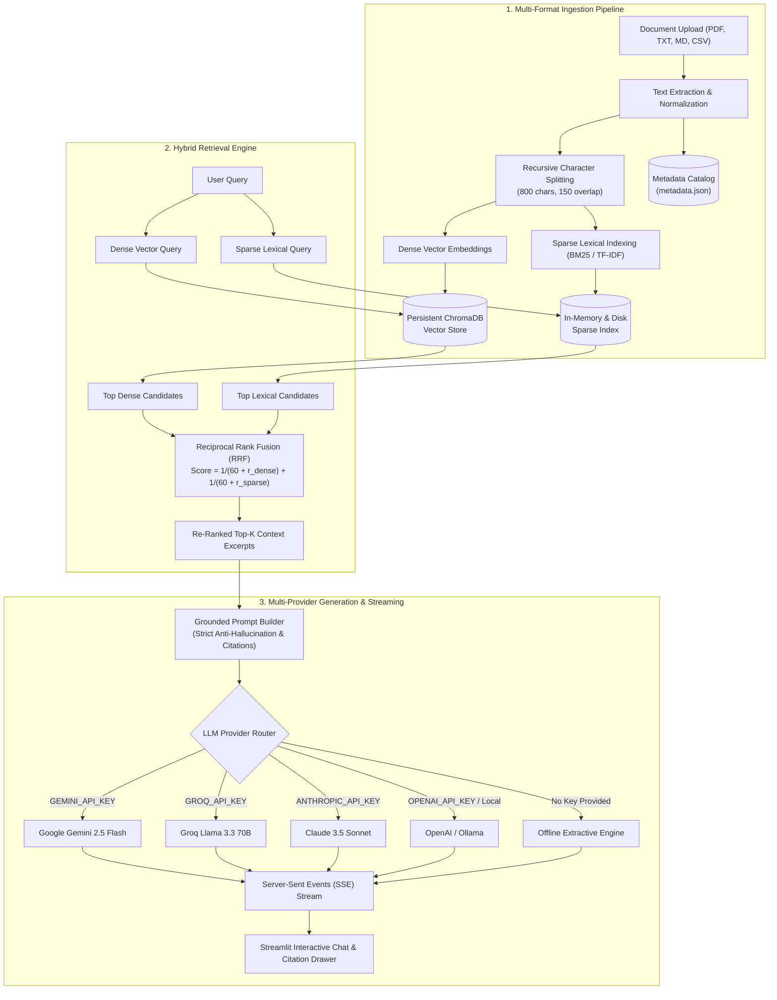

# 🧠 Enterprise Hybrid RAG (Retrieval-Augmented Generation)

[](https://www.python.org/)
[](https://fastapi.tiangolo.com/)
[](https://streamlit.io/)
[](https://www.trychroma.com/)
[](LICENSE)

An advanced, production-grade **Retrieval-Augmented Generation (RAG)** platform designed for querying multi-format knowledge bases with high precision, verified citations, and zero hallucinations.

---

## 🌟 What Was Improved? (Before vs. After)

| Feature | Simple Toy RAG (Previous) | Enterprise Hybrid RAG (Current) |
| :--- | :--- | :--- |
| **Document Support** | PDF only (crashed if PyMuPDF was missing) | **Universal**: PDF (`pypdf` + `fitz` fallback), TXT, Markdown (`.md`), CSV |
| **Retrieval Strategy** | Naive Vector-only Cosine Similarity | **Hybrid Search**: Dense Vector Embeddings + Sparse BM25 / TF-IDF Lexical Index |
| **Rank Fusion** | None (pure single-vector distances) | **Reciprocal Rank Fusion (RRF)** with rank constant $k=60$ for superior recall |
| **LLM Support** | Hardcoded to Anthropic Claude only | **Multi-Provider**: Google Gemini, Groq (Llama 3.3), Claude, OpenAI, Local Ollama |
| **Zero-Key Execution** | Crashed immediately without `ANTHROPIC_API_KEY` | **Offline Extractive Fallback Mode**: Generates cited answers out-of-the-box |
| **Streaming UI** | Frozen spinner waiting for full generation | **Real-Time Token Streaming**: SSE streaming with live typewriter typing effect |
| **Knowledge Base Scope** | Single document only, isolated in memory | **Global vs Document Target**: Search across entire knowledge library or single file |
| **Persistence** | In-memory python dict (lost on server restart) | **Persistent Disk Catalog** (`data/metadata.json` + ChromaDB persistent vector store) |
| **Hallucination Guard** | Basic prompt | **Strict Grounding Guardrails**: Page citations, confidence scores, source previews |
| **Verification Suite** | None | Automated end-to-end test suite (`python test.py`) |

---

## 🏗️ System Architecture



---

## 🚀 Quickstart Guide

### 1. Prerequisites
- Python **3.10+**

### 2. Installation
```bash
python -m pip install -r requirements.txt
```

### 3. Environment Configuration
Copy the `.env.example` file to `.env`:
```bash
cp .env.example .env
```

Add your preferred API key (Gemini, Groq, Claude, or OpenAI), or run in offline extractive mode with zero keys.

### 4. Running the Stack
- **Terminal 1 (Backend API):**
  ```bash
  python main.py
  ```
- **Terminal 2 (Streamlit UI):**
  ```bash
  streamlit run app.py
  ```
- **Automated Verification:**
  ```bash
  python ../test.py
  ```

---

## 📁 Directory Layout

```
files/
├── rag_pipeline.py       # Ingestion, chunking, ChromaDB, BM25, RRF, LLM routers
├── main.py               # FastAPI backend: REST API, SSE streaming, document CRUD
├── app.py                # Streamlit UI: Chat interface, Knowledge Base explorer, citations
├── requirements.txt      # Clean project dependencies
├── .env.example          # Backend environment template
├── README.md             # Complete documentation
└── data/                 # Auto-generated persistent storage
    ├── uploads/          # Raw document files
    ├── chroma_db/        # Persistent ChromaDB vector collections
    └── metadata.json     # Persistent document catalog
```
